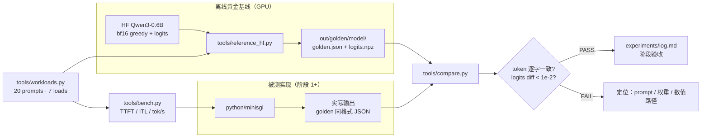

# Mini-SGLang 复现路线图

> 面向：已经了解推理引擎基本结构（prefill / decode、KV Cache、连续批处理、TP 等概念），希望从零写出一套"能跑、能服务、能优化、能解释"的 LLM 推理引擎的学习者。
>
> 用法：按阶段推进。每个阶段结束时，系统必须仍然可运行，并且留下一个可复现的正确性基线与性能数字。参考实现是本仓库的 `python/minisgl/`，建议先自己写，卡住后再对照，而不是一开始逐行抄。

---

## 0. 开始之前

### 0.1 环境前提（很重要）

Mini-SGLang 依赖 CUDA kernel（`sgl-kernel`、`flashinfer`、`tvm-ffi` JIT），**只能在 Linux + NVIDIA GPU 上运行**。macOS 和 Windows 原生环境不支持。

如果你当前在 macOS 上（本仓库工作区就是 macOS），请先准备以下任一运行环境：

- 一台带 NVIDIA GPU 的 Linux 服务器（推荐，后续 TP 至少需要 2 卡）；
- WSL2 + NVIDIA 驱动；
- 带 GPU 的 Docker 容器（仓库自带 `Dockerfile`）。

推荐配置：

| 项目 | 建议 |
| --- | --- |
| OS | Ubuntu 22.04 / 24.04 |
| GPU | 单卡 ≥ 16 GB（Qwen3-0.6B 足够；TP 阶段用 2 卡） |
| Python | 3.10 / 3.11 / 3.12 |
| 包管理 | `uv` |
| 首个模型 | `Qwen/Qwen3-0.6B`（GQA + QK Norm，结构覆盖面广） |

```bash
uv venv --python=3.12
source .venv/bin/activate
uv pip install -e ".[dev]"
python -c "import torch; print(torch.cuda.get_device_name(0))"
```

> 如果 HuggingFace 下载受限，使用 `--model-source modelscope`。

### 0.2 七条复现原则

1. **先正确，后性能。** 任何优化之前，必须有一个可信的"黄金输出"作为裁判。
2. **一次只引入一个优化。** 每加一个特性，都要能单独关闭它并量化差异（ablation），否则你无法解释收益来源。
3. **每个阶段保持系统可运行。** 不要连续两周处于"编译不过/跑不起来"的状态。
4. **接口先行。** 先把 `BaseOP`、`BaseAttnBackend`、`BasePrefixCache` 这类接口定下来，再填实现。这样后面替换 kernel 或后端时不用重写业务逻辑。
5. **先用 PyTorch 参考实现，再替换高效实现。** `store_kv` 可以先用 `index_copy_`，RoPE 可以先用 torch，attention 可以先用 SDPA。正确性对齐后再换 FlashAttention / FlashInfer / 自定义 CUDA kernel。
6. **不要过早抽象，也不要过早优化。** 单请求阶段不需要 paged KV；单卡阶段不需要 TP 代码路径，但接口要预留。
7. **读代码要有边界。** 每个阶段只读对应模块和对应文档，先画数据流，再看实现细节。

### 0.3 建议的工程脚手架

```
my-sgl/
├── python/minisgl/          # 你自己的实现
├── tools/
│   ├── reference_hf.py      # 黄金基线：HF 生成 + logits
│   ├── compare.py           # 对比你的输出与黄金输出
│   ├── bench.py             # TTFT / ITL / throughput
│   └── workloads.py         # 固定测试负载
├── tests/
│   ├── test_reference.py    # 端到端正确性
│   ├── test_cache.py        # 页分配 / 淘汰 / 完整性
│   └── test_scheduler.py    # 调度生命周期
├── experiments/
│   └── log.md               # 每次实验的记录
└── README.md
```

工程习惯：

- 每个阶段一个分支：`stage-02-kvcache`；验收通过后打 tag：`v0.2-kvcache`。
- 所有优化都做成配置项（CLI flag 或环境变量），保证"一键回到上一阶段"。
- 性能数字必须和**固定负载 + 固定模型 + 固定 dtype** 绑定。
- 每次实验记录：日期、commit、配置、TTFT、ITL p50/p99、吞吐、峰值显存、备注。

固定测试负载建议至少包含：

| 负载 | 目的 |
| --- | --- |
| 短 prompt（32 tokens）× 1 | 验证 decode 与小 batch |
| 中等 prompt（512 tokens）× 8 | 验证常规 prefill + 并发 |
| 长 prompt（8k / 32k）× 1 + 并发 decode | 验证 chunked prefill 与 ITL |
| 共享前缀（两个请求共享 4k 前缀） | 验证 radix cache |
| 突发 32 请求 | 验证调度、容量、稳定性 |
| 混合长度 + 不同 max_tokens | 验证生命周期与公平性 |

### 0.4 仓库使用方式

参考实现按模块划分，建议的阅读顺序与实现顺序一致：

```
core → layers → models → kvcache → attention → scheduler → engine → message/tokenizer/server → distributed → kernel
```

每个阶段开始前，只读该阶段对应的 1~3 个文件；实现完成后，再对照参考实现检查差异。

---

## 1. 全局地图

### 1.1 阶段总览

| 阶段 | 主题 | 解决的问题 | 核心新增模块 | 阶段产物 | 优先级 / 参考工时 |
| --- | --- | --- | --- | --- | --- |
| 0 | 环境与黄金基线 | 没有"对错"标准 | 测试与基准脚手架 | 可复现的 HF 基线 | 必做 / 2–3 天 |
| 1 | 最小生成器 | 模型怎么跑起来 | `layers`、`models`、`core.SamplingParams` | 单请求逐 token 生成 | 必做 / 5–8 天 |
| 2 | KV Cache 与批量前向 | decode 每步重算全部 K/V；只能单请求 | `core`、`kvcache`、`attention` 基础、页表 | 带缓存的多请求 batch | 必做 / 7–10 天 |
| 3 | 连续批处理调度器 | 请求动态到达，静态 batch 浪费 | `scheduler`、`engine`、`llm`、Sampler | 单进程并发 LLM 服务 | 必做 / 5–7 天 |
| 4 | 分块预填充 | 长 prompt 撑爆预算、阻塞 decode | `ChunkedReq`、`PrefillAdder` | 长上下文稳定服务 | 必做 / 3–4 天 |
| 5 | 前缀缓存 | 重复前缀重复计算、重复占显存 | `radix_cache`、`CacheManager` | 共享前缀加速 + 淘汰 | 必做 / 5–7 天 |
| 6 | 服务化 | 没有 API、没有进程边界 | `message`、`zmq`、`tokenizer`、`server` | OpenAI 兼容流式服务 | 必做 / 6–8 天 |
| 7 | 高性能注意力后端 | torch attention 太慢 | `attention/fa.py`、`attention/fi.py` | FA / FlashInfer 接入 | 推荐 / 5–7 天 |
| 8 | CUDA Graph | 小 batch decode 的 CPU launch 开销高 | `engine/graph.py` | decode 提速 | 推荐 / 3–5 天 |
| 9 | 重叠调度 | CPU 调度串行阻塞 GPU | overlap loop、双 stream | 吞吐提升 | 推荐 / 5–7 天 |
| 10 | 张量并行 | 单卡放不下 / 不够快 | `distributed`、TP layers | 多卡服务 | 推荐 / 7–10 天 |
| 11 | MoE 与自定义 Kernel | 模型与算子覆盖不足 | `moe`、`kernel`、`csrc` | Qwen3-MoE | 可选 / 7–10 天 |
| 12 | 性能剖析与验收 | 收益说不清、无法解释 | benchmark + ablation | 完整对比报告 | 必做 / 3–5 天 |

> 工时按"有 GPU、每天能投入 2–3 小时"估算，仅供排期参考，不是硬指标。

### 1.2 主线：每一步解决上一步暴露的瓶颈

```mermaid
flowchart LR
    S0["0 基线"] --> S1["1 最小生成器"]
    S1 -->|"decode 重算 O(L²)"| S2["2 KV Cache + 批量"]
    S2 -->|"请求动态到达"| S3["3 连续批处理"]
    S3 -->|"长 prompt 撑爆预算"| S4["4 分块预填充"]
    S4 -->|"重复前缀浪费"| S5["5 Radix Cache"]
    S5 -->|"需要真实服务"| S6["6 服务化"]
    S6 -->|"torch attention 慢"| S7["7 高性能后端"]
    S7 -->|"小 batch CPU 开销"| S8["8 CUDA Graph"]
    S8 -->|"调度仍阻塞 GPU"| S9["9 重叠调度"]
    S9 -->|"单卡不够"| S10["10 张量并行"]
    S10 --> S11["11 MoE / 自定义 Kernel"]
    S11 --> S12["12 剖析与验收"]
```



### 1.3 阶段衔接表

| 完成阶段后你拥有 | 它暴露的新问题 | 因此进入 |
| --- | --- | --- |
| 0：可信的正确性与指标 | 还没有推理引擎 | 1：把模型跑起来 |
| 1：单请求生成 | decode 每一步都要重算整个序列的 K/V，复杂度 O(L²) | 2：KV Cache + 批量前向 |
| 2：带 KV 的多请求 batch | 请求在不同时刻到达/完成，静态 batch 浪费显存和算力 | 3：连续批处理 |
| 3：连续批处理 | 长 prompt 一次性占满 token budget，decode 被饿死或 OOM | 4：分块预填充 |
| 4：分块预填充 | 相同系统提示/文档前缀被反复计算、反复占用显存 | 5：前缀缓存 |
| 5：前缀缓存 | 只能进程内调用，没有并发客户端和真实 API | 6：服务化 |
| 6：服务化 | PyTorch attention 在长序列/大 batch 下性能不足 | 7：高性能注意力后端 |
| 7：高性能后端 | 小 batch decode 时 CPU 端 launch 开销占比显著 | 8：CUDA Graph |
| 8：CUDA Graph | 调度、metadata 构造、H2D 拷贝仍串行阻塞 GPU | 9：重叠调度 |
| 9：重叠调度 | 单卡显存或算力成为上限 | 10：张量并行 |
| 10：张量并行 | 稠密模型与 Python 侧算子覆盖不足 | 11：MoE + 自定义 kernel |
| 11：完整功能 | 各项优化的收益无法量化、无法解释 | 12：剖析、调优与验收 |

### 1.4 里程碑

| 里程碑 | 达到阶段 | 验收标志 |
| --- | --- | --- |
| M1 正确生成 | 0–1 | 单请求 greedy 输出与 HF 逐 token 一致 |
| M2 批量引擎 | 2–3 | 多请求并发输出正确，吞吐高于串行 |
| M3 真实服务 | 4–6 | OpenAI API 流式/非流式可用，长上下文稳定 |
| M4 性能引擎 | 7–9 | 接入高性能后端、CUDA Graph、重叠调度 |
| M5 分布式与终验 | 10–12 | TP 可用，完成 ablation 报告 |

### 1.5 两条推荐路径

| 路径 | 包含阶段 | 适合 |
| --- | --- | --- |
| 核心路径 | 0, 1, 2, 3, 4, 5, 6, 9, 12 | 时间有限，但想覆盖推理引擎最核心的结构与优化 |
| 完整路径 | 0–12 | 希望完整复现仓库全部特性 |

---

## 2. 分阶段实现

每个阶段统一包含：目标、为什么在这个阶段、要实现的模块、关键设计点、验收标准、常见坑。

---

### 阶段 0：环境、模型与黄金基线

**目标**：搭好可运行的 Linux/CUDA 环境，并建立一套可信的"正确性裁判"和性能测量工具。

**为什么先做**：后面每一个阶段都会改动数值路径（KV Cache、attention 后端、TP、kernel）。没有一个独立的黄金基线，你无法判断"输出变差"是 bug 还是精度差异。这个阶段是整个项目的安全网。

**要实现的模块**

- `tools/reference_hf.py`
  - 加载 `Qwen/Qwen3-0.6B`（bf16）。
  - 对固定 prompt 做 greedy 生成（`do_sample=False`），保存 input ids、output ids。
  - 对固定 input ids 做一次 forward，保存最后一个位置的 logits，便于逐层/逐阶段对比。
- `tools/workloads.py`：定义 0.3 中的固定负载。
- `tools/bench.py`：至少能测 TTFT、单步 decode 延迟、输出 token 吞吐。
- `tests/test_reference.py`：调用 `tools/compare.py` 做端到端比对。
- `experiments/log.md`：实验记录模板。

**关键设计点**

- **区分两种对比**：
  - token 级：greedy 输出必须逐 token 完全一致。
  - logits 级：bf16 下允许 `max_abs_diff < 1e-2`；fp32 调试时收紧到 `1e-3`。
- prompt 统一使用 **raw token ids**，先不要套 chat template；chat template 留到服务化阶段单独验证。
- 明确 `eos_token_id`、`max_tokens`、`ignore_eos` 的语义，后续所有阶段复用同一套定义。
- 记录 GPU 型号、驱动、torch / flashinfer / sgl-kernel 版本，避免"昨天能跑今天不能跑"。

**验收标准**

- 同一条命令连续跑两次，greedy 输出完全一致。
- 黄金结果落盘（JSON / safetensors 均可），并有 `compare` 命令一键回归。
- 能打印：prefill 耗时、每步 decode 耗时、峰值显存。

**阶段架构图**



**测试命令**

```bash
# 1. CPU 单测：负载定义、对比工具、小模型解码语义（无 GPU 可跑）
pytest tests/test_workloads.py tests/test_compare.py tests/test_hf_runtime.py -q

# 2. 生成黄金基线并验证可复现性（GPU）
python tools/reference_hf.py --model Qwen/Qwen3-0.6B
python tools/reference_hf.py --model Qwen/Qwen3-0.6B --check-determinism

# 3. 端到端回归：重新生成输出并与落盘基线逐 token 对比（GPU）
pytest tests/test_reference.py -m "gpu and slow"

# 4. 手动对比任意一次运行（退出码 0 = PASS）
python tools/compare.py --baseline out/golden/Qwen__Qwen3-0.6B/golden.json \
                        --actual   out/run/golden.json

# 5. 基线性能数字（GPU）
python tools/bench.py --model Qwen/Qwen3-0.6B --load all
```

> 基线尚未生成时，`tests/test_reference.py` 会 skip 而不是失败；先执行第 2 步。

**常见坑**

- 用 chat template 做基线、用 raw prompt 做复现，导致从第一个 token 开始就对不上。
- tokenizer 的 `padding_side`、`add_special_tokens` 不一致。
- 在 bf16 下要求逐位相等；应比较 argmax 与容差。
- GPU 架构不同会改变 attention 后端行为（FA2/FA3），先固定一台机器。

---

### 阶段 1：最小生成器（模型 + 权重 + 单请求循环）

**目标**：用纯 PyTorch 实现 `forward(input_ids) -> logits`，并完成"prefill + 逐 token 重算"的贪心生成。此时**还没有 KV Cache**。

**为什么在这个阶段**：先把模型结构、权重加载、RoPE、注意力、采样这些"数值正确性"问题全部解决。它们是后续所有优化的地基。这个阶段的 decode 会非常慢，而正是这种慢，让你直观看到 KV Cache 的必要性。

**要实现的模块**

| 模块 | 职责 | 参考文件 |
| --- | --- | --- |
| `core.py` | `SamplingParams`：temperature / top_k / top_p / ignore_eos / max_tokens | `python/minisgl/core.py` |
| `layers/base.py` | `BaseOP`：`state_dict` / `load_state_dict` 协议；`StateLessOP`；`OPList` | `python/minisgl/layers/base.py` |
| `layers/norm.py` | RMSNorm（先用 torch 实现） | `python/minisgl/layers/norm.py` |
| `layers/linear.py` | 普通 Linear（暂不做 TP） | `python/minisgl/layers/linear.py` |
| `layers/rotary.py` | RoPE：预计算 cos/sin cache，按 positions 应用 | `python/minisgl/layers/rotary.py` |
| `layers/attention.py` | `AttentionLayer`：QKV 拆分、QK Norm、RoPE、SDPA | `python/minisgl/layers/attention.py` |
| `layers/activation.py` | `silu_and_mul` / `gelu_and_mul` | `python/minisgl/layers/activation.py` |
| `layers/embedding.py` | Embedding、LM Head（先不做 vocab 并行） | `python/minisgl/layers/embedding.py` |
| `models/config.py` | `ModelConfig.from_hf` | `python/minisgl/models/config.py` |
| `models/base.py` | `BaseLLMModel` | `python/minisgl/models/base.py` |
| `models/llama.py` | Llama DecoderLayer / Model / CausalLM | `python/minisgl/models/llama.py` |
| `models/qwen3.py` | Qwen3（含 QK Norm） | `python/minisgl/models/qwen3.py` |
| `models/weight.py` | safetensors 流式加载；先做简单 key 映射 | `python/minisgl/models/weight.py` |
| `engine/sample.py` | greedy `argmax` | `python/minisgl/engine/sample.py` |
| `scripts/generate_naive.py` | prefill + 每步重算全序列 | — |

**关键设计点**

1. **state_dict 协议要严格。** `load_state_dict` 结束时如果还有剩余 key，直接报错。这是发现权重映射错误最快的方式。
2. **模型结构先做 Llama，再做 Qwen3。** Llama 无 bias、无 QK Norm；Qwen3 增加 per-head QK Norm。按这个顺序能清晰看到差异。
3. **RoPE 方向。** HuggingFace 使用 `rotate_half`（前后半轴旋转），不是相邻元素交错。用固定 position 的数值对比 HF 验证。
4. **GQA。** `num_kv_heads < num_qo_heads` 时，KV 头需要广播到对应的 Q 头；映射关系是整除分组，不是取模。
5. **causal mask。** 单请求 prefill 用一次 causal mask；decode 时 Q 只有 1 个 token，可省略 mask 或使用正确的 offset。
6. **只算需要的 logits。** prefill 阶段只需要最后一个位置的 logits 用于生成，但为了与 HF 对比可以让模型输出全部。
7. **权重先不融合。** q/k/v 分开加载、gate/up 分开加载都可以；融合是后续性能阶段的事。但 weight key 的命名要提前想好，避免后面大改。

**验收标准**

- 固定 prompt 的 logits 与 HF 对比通过（bf16 容差内）。
- 20 条 prompt 的 greedy 输出与 HF **逐 token 完全一致**。
- Llama 与 Qwen3 都能生成。
- 记录一组数据：随着序列长度从 128 增长到 2048，单步 decode 耗时如何增长。这个数字是阶段 2 的动机。

**常见坑**

- RMSNorm 的 eps、计算 dtype、weight 初始化位置。
- Qwen3 的 QK Norm 作用在 head_dim 上，不是 hidden_size。
- `tie_word_embeddings` 时 LM Head 与 Embedding 共享权重；不要重复加载。
- HF 的 `attention_mask` 默认全 1；如果你手动构造 mask，注意 dtype 和 shape。
- 采样时 `argmax` 在 bf16 logits 上做，还是转 fp32 后做；与基线保持一致。
- 生成循环里忘记把新 token 拼回输入，或者忘记更新 position。

**阶段结束时的反思**

> 每生成 1 个 token，都要重新计算全部 L 个 token 的 K/V 和注意力。显存随 L 线性增长，计算随 L² 增长。如果能把已经算过的 K/V 存下来，decode 就只需要算 1 个 token。这就是阶段 2。

---

### 阶段 2：KV Cache、批量前向与 Paged Attention

**目标**：实现增量 decode 和多请求 batch forward；把 KV Cache 组织成可分页管理的池子；抽象出 attention backend 接口。

**为什么在这个阶段**：阶段 1 的瓶颈是"重复计算"。KV Cache 解决重复计算，但一旦缓存跨请求共享，就必须回答"每个请求的 K/V 存在哪里、如何定位、如何回收"。分页（paged）是标准答案。

**要实现的模块**

| 模块 | 职责 | 参考文件 |
| --- | --- | --- |
| `core.py` | `Req`、`Batch`、`Context`、全局 context | `python/minisgl/core.py` |
| `kvcache/base.py` | `BaseKVCachePool`、`BaseCacheHandle` | `python/minisgl/kvcache/base.py` |
| `kvcache/mha_pool.py` | MHA KV 池；`store_kv` 先用 torch fallback | `python/minisgl/kvcache/mha_pool.py` |
| `kvcache/naive_cache.py` | 无操作的前缀缓存（占位） | `python/minisgl/kvcache/naive_cache.py` |
| `scheduler/table.py` | 请求槽位分配 + `token_pool` | `python/minisgl/scheduler/table.py` |
| `scheduler/cache.py` | 页分配器：`_allocate` / `_free` / `_page_to_token` / 写页表 | `python/minisgl/scheduler/cache.py` |
| `attention/base.py` | `BaseAttnMetadata`、`BaseAttnBackend` | `python/minisgl/attention/base.py` |
| `attention/torch_backend.py` | 你自己的参考后端：gather KV + SDPA | — |
| `scheduler/batch.py` | 组装 `input_ids` / `positions` / `out_loc` | 参考 `Scheduler._prepare_batch` |
| `scheduler/loop.py` | 最小调度：prefill 全部 pending，再 decode 全部 running | — |

**建议拆成 5 个小步，每步都保持可运行：**

1. **单请求 + 连续 KV Cache。** 每个请求一块连续 KV 显存，decode 只写 1 个位置。验证输出与阶段 1 完全一致。
2. **多请求 batch。** 把所有请求的 token 拼成一条扁平序列，用 `cu_seqlens` 区分边界；prefill 一次算多个请求。
3. **Paged KV（page_size = 1）。** KV 池按"页"组织，页表把逻辑位置映射到物理 token 槽位。
4. **page_size > 1。** 一次分配多 token 的页；页内地址连续；注意 cached_len 与页边界对齐。
5. **Extend prefill。** 模拟"前缀已缓存"的情况：Q 长度 < K 长度，causal mask 需要偏移。

**关键设计点**

- **KV 池布局**：`(2, num_layers, num_pages + 1, page_size, local_kv_heads, head_dim)`。`+1` 是 dummy page，给 CUDA Graph 的填充请求用。`2` 表示 K 和 V。
- **页表语义**：参考实现让 `Context.page_table` **始终按 page_size=1 记录"原始 token 槽位"**，形状为 `(max_running_req + 1, aligned_max_seq_len)`，int32，列数按 32 对齐，最后一行是 dummy 请求。attention 后端在边界处再把 token 槽位换算成页号。这样做的好处是调度器逻辑统一、后端实现简单；代价是页表本身占显存（`max_req × max_seq_len`）。
- **`out_loc`**：本次 forward 算出的每个 token 的 K/V 应该写到的物理槽位。prefill 时是 `page_table[table_idx, cached_len:device_len]`；decode 时是该请求新位置对应的一个槽位。
- **写 KV 的时机**：attention 计算前，先把本次的 K/V 写入缓存，这样 attention 读取时能包含当前 token（decode 的 self-attention 需要）。
- **`Req` 的状态机**：
  - `cached_len`：已经算过并写入 KV 的长度；
  - `device_len`：当前在 GPU 上参与计算的序列长度；
  - `max_device_len = input_len + output_len`；
  - `extend_len = device_len - cached_len`；
  - `complete_one()`：`cached_len = device_len; device_len += 1`。
- **positions**：每个 token 的绝对位置。prefill 是 `cached_len..device_len-1`；decode 是单个 `cached_len`。
- **批量 attention 的两种实现**：
  - 参考实现（先写）：按请求循环，gather 出每个请求的 K/V，逐请求 SDPA；
  - 进阶实现：varlen attention，用 `cu_seqlens` 一次算完。
- **page_size > 1 的分配**：空闲列表里存的是页起始 token 槽位（如 page_size=2 时是 `[0, 2, 4, ...]`），分配后展开为连续 token 槽位写入页表。

**验收标准**

- 单请求增量 decode 的输出与阶段 1 完全一致。
- 4 个不同长度请求合批，输出与逐个单独运行完全一致。
- page_size = 1 / 4 / 16 三种配置输出一致。
- 人为构造共享页/跨界位置，不出现越界或串请求污染。
- 请求结束后，页分配器能完整回收；`free_pages + used_pages == num_pages`。
- 记录：不同 batch size、不同序列长度下的 decode 延迟与显存占用。

**常见坑**

- **索引 dtype**：页表、`out_loc`、`positions` 用 int32 还是 int64 不一致，会导致 kernel 或 gather 报错。
- **causal mask 偏移**：extend prefill 中，第 i 个 Q 只能看到位置 ≤ `cached_len + i` 的 K；直接 `is_causal=True` 会错。
- **GQA 映射**：Q 头到 KV 头用 `q_head // (num_qo_heads // num_kv_heads)`。
- **写 KV 与读 KV 的顺序**：先 store 再 attention。
- **页表越界**：为每个请求分配 `ceil(max_device_len / page_size)` 页，而不是只按当前长度分配。
- **batch 内请求顺序**：后续 TP 要求所有 rank 的顺序一致，尽早按 `uid` 排序。
- **padding / dummy 请求**：现在可以不做，但设计时给 CUDA Graph 留好 dummy page 的位置。

**阶段结束时的反思**

> 已经能批量跑了，但调度还是"来一批、算一批"。真实服务中请求随时到达、随时结束。需要一个能动态增删请求、管理容量和生命周期的调度器。

---

### 阶段 3：连续批处理调度器与采样

**目标**：实现单进程的 `Scheduler + Engine + LLM`，支持请求动态加入/完成/中止，按 iteration 组 batch，完成容量管理与每请求采样。

**为什么在这个阶段**：阶段 2 的 batch 是静态的。连续批处理（continuous batching）让每个 iteration 重新决定"这一轮算哪些请求"，从而让长短请求混跑、新请求及时进入、完成的请求及时退出。

**要实现的模块**

| 模块 | 职责 | 参考文件 |
| --- | --- | --- |
| `scheduler/config.py` | `SchedulerConfig` / `EngineConfig` | `python/minisgl/scheduler/config.py`、`python/minisgl/engine/config.py` |
| `scheduler/utils.py` | `PendingReq` | `python/minisgl/scheduler/utils.py` |
| `scheduler/prefill.py` | `PrefillManager`：pending 队列、准入、组 prefill batch（本阶段先不分块） | `python/minisgl/scheduler/prefill.py` |
| `scheduler/decode.py` | `DecodeManager`：running 集合、`inflight_tokens` | `python/minisgl/scheduler/decode.py` |
| `scheduler/cache.py` | `CacheManager`：页分配、释放、`allocate_paged` | `python/minisgl/scheduler/cache.py` |
| `scheduler/table.py` | 请求槽位与 `token_pool` | `python/minisgl/scheduler/table.py` |
| `scheduler/scheduler.py` | 主循环、消息处理、`_prepare_batch`、`_forward`、`_process_last_data` | `python/minisgl/scheduler/scheduler.py` |
| `engine/engine.py` | 模型、KV 池、页表、采样器、`forward_batch` | `python/minisgl/engine/engine.py` |
| `engine/sample.py` | 每请求 temperature / top_k / top_p；greedy 快路径 | `python/minisgl/engine/sample.py` |
| `llm/llm.py` | 离线接口 `LLM.generate()` | `python/minisgl/llm/llm.py` |
| `env.py` | 特性开关 | `python/minisgl/env.py` |

**主循环伪代码**

```python
while True:
    runnable = prefill_manager.runnable or decode_manager.runnable
    msgs = receive_msg(blocking=not runnable)   # 没活干才阻塞
    for msg in msgs:
        handle(msg)                              # add / abort / exit

    batch = prefill_manager.schedule_next_batch(budget) or \
            decode_manager.schedule_next_batch()
    if batch is not None:
        prepare_batch(batch)                     # 页分配、positions、out_loc、metadata
        output = engine.forward_batch(batch)     # 模型 + 采样
        process_output(output)                   # 追加 token、判断结束、发结果
    else:
        run_when_idle()                          # 完整性检查等
```

**关键设计点**

- **容量计算**：`num_pages = (memory_ratio × 初始空闲显存 − 模型占用) // 每页字节数`。每页字节数 = `2 × head_dim × local_kv_heads × page_size × dtype_bytes × num_layers`。
- **准入控制**：prefill 新请求时，既要给它的输入留 token budget，也要给它未来的输出预留显存；同时要扣掉正在 decode 的请求的 `inflight_tokens`（剩余输出 + 每请求预留 1 页）。否则会在 decode 中途 OOM。
- **请求生命周期**：
  - 加入：`PendingReq` -> prefill -> 进入 `DecodeManager`；
  - 完成：达到 `max_tokens`，或生成 `eos`（且未设置 `ignore_eos`）；
  - 中止：客户端断开 -> `AbortMsg` -> 从 prefill/decode 队列移除 -> 释放槽位与页。
- **采样**：
  - 全 greedy 时直接 `argmax`，避免构造多余张量；
  - 只有存在非 greedy 请求时才构造 per-request 的 temperature/top-k/top-p 张量；
  - 采样在 GPU 上批量完成，结果异步拷回 CPU（pinned memory + event）。
- **输出回写**：本轮生成的 token 写回 `token_pool` 的对应位置，下一轮 decode 从 `token_pool` 读取输入 token。
- **确定性**：decode batch 按 `uid` 排序。这样后续 TP 所有 rank 的调度顺序一致，也便于复现实验。
- **完整性检查**：空闲时调用 `cache_manager.check_integrity()`，确保 `free_pages + cache_pages == num_pages`。

**验收标准**

- 50 条混合长度请求并发，输出与"逐条串行运行"完全一致。
- 吞吐显著高于 batch=1 的串行基线（记录数字）。
- 连续压测 1000 条请求后，完整性检查通过，显存不增长。
- 中止请求后，槽位和页能被回收，后续请求正常。
- `max_running_req` 生效；超过上限的请求排队而不是报错。
- temperature=0 / top_k=1 / top_p<1 等采样配置行为正确。

**常见坑**

- 结束判断放在追加 token 之前/之后不一致，导致少输出一个 token。
- `eos` 被当成输出 token 发给用户，或 `ignore_eos` 时错误结束。
- decoder 完成后忘记从 `running_reqs` 移除，导致重复 decode。
- prefill 时没有给输出预留空间，decode 中途 OOM。
- 页释放发生在结果处理之前，导致下一轮读到脏数据。
- 采样参数全 greedy 时仍然构造了 GPU 张量，增加无谓开销。

**阶段结束时的反思**

> 现在长 prompt 会一次性占用大量 token budget，导致正在 decode 的请求长时间得不到执行，ITL 出现尖峰；极端情况下还会 OOM。需要把 prefill 切成小块，与 decode 交错执行。

---

### 阶段 4：分块预填充与调度策略

**目标**：实现 chunked prefill：把长 prompt 拆成多个 chunk，分多个 iteration 计算，并让 decode 请求能插入其间。

**为什么在这个阶段**：连续批处理解决了"请求动态进出"，但没有解决"单个请求太大"。分块预填充（Sarathi-Serve）把"长 prefill 阻塞一切"变成"小块交错执行"，从而降低 TTFT 抖动和峰值显存。

**要实现的模块**

- `scheduler/prefill.py`
  - `ChunkedReq(Req)`：`can_decode=False`，禁止被采样；`append_host` 抛错。
  - `PrefillAdder`：token budget、已预留容量、缓存匹配、表槽分配、估算与准入。
  - `PrefillManager.schedule_next_batch()`：按 FCFS 逐个尝试加入，预算耗尽即停止。
- `scheduler/scheduler.py`：在 pending 中保存 `chunked_req`，下一轮复用同一个 `table_idx` 与 `cached_len`。
- `scheduler/config.py`：`max_extend_tokens`（CLI：`--max-prefill-length`）。
- 可选：调度策略（prefill-first / decode-first / 公平轮转）。

**关键设计点**

- **切块规则**：`chunk_size = min(token_budget, remain_len)`；若 `chunk_size < remain_len`，本轮生成的是 `ChunkedReq`。
- **跨轮状态**：`pending_req.chunked_req` 指向上一轮的 chunk；下一轮继续用它的 `table_idx` 和 `cached_len`，不再重新匹配前缀缓存。
- **预算共享**：一个 iteration 的 token budget 由所有被选中的请求共享；某个请求加不进去就停止，保证本轮不会超预算。
- **输出预留**：准入时用 `extend_len + output_len + reserved_size` 估算，`reserved_size` 包含 in-flight decode 的剩余 token。
- **缓存写入时机**：chunked 请求在最后一个 chunk 完成前不进入 decode，也不做前缀缓存插入；只有完整 prefill 结束后才插入。
- **页分配**：只给 `[cached_len, device_len)` 新覆盖的页分配；跨 chunk 时页边界可能落在 chunk 中间，注意对齐。
- **策略权衡**：
  - chunk 太小：prefill 被切得太碎，GPU 利用率下降，TTFT 变差；
  - chunk 太大：长 prompt 仍然阻塞 decode，ITL 尖峰；
  - 建议从 2048 或 4096 开始做 ablation。

**验收标准**

- 32k prompt + 8 个并发 decode：不 OOM，所有输出正确。
- 记录 chunk size = 512 / 2048 / 8192 时的 TTFT、ITL p50/p99、吞吐，画出权衡曲线。
- 中止一个正处于 chunk 中间的请求，资源能正确回收。
- chunk 边界跨越页边界时输出正确。
- 与阶段 3 相比：长 prompt 场景的 ITL p99 明显下降；短 prompt 场景吞吐不应明显退化。

**常见坑**

- 对 `ChunkedReq` 做采样或发送输出。
- 下一轮重新走 `match_prefix`，导致 `cached_len` 回退。
- 只按 `remain_len` 估算容量，忘记输出 token 的预留。
- 预算太小导致永远无法完成一个 chunk，形成活锁。
- chunked 请求结束后提前插入缓存，或重复插入。
- 中止时只删了 pending，没有释放已分配的页。

**阶段结束时的反思**

> 现在每个请求都能稳定跑完，但两个请求如果共享同一段系统提示或文档前缀，它们仍然会各自算一遍、各自占一份显存。需要跨请求的 KV 复用。

---

### 阶段 5：前缀缓存（Naive → Radix Cache）

**目标**：实现跨请求的前缀 KV 复用和显存淘汰。先保留一个"无操作"的 naive 实现作为对照，再实现 radix tree。

**为什么在这个阶段**：阶段 2–4 已经建立了"缓存句柄"和"页表"的抽象；现在只需要替换前缀缓存实现，就能获得跨请求复用，而不用改动 attention 和模型代码。这是"接口先行"的回报。

**要实现的模块**

| 模块 | 职责 | 参考文件 |
| --- | --- | --- |
| `kvcache/base.py` | `BasePrefixCache` / `BaseCacheHandle` / `SizeInfo` / `InsertResult` / `MatchResult` | `python/minisgl/kvcache/base.py` |
| `kvcache/naive_cache.py` | 永远不命中、永不淘汰（阶段 3 已用） | `python/minisgl/kvcache/naive_cache.py` |
| `kvcache/radix_cache.py` | 节点、匹配、插入、分裂、淘汰、锁 | `python/minisgl/kvcache/radix_cache.py` |
| `scheduler/cache.py` | `cache_req` 生命周期；lazy free；完整性检查 | `python/minisgl/scheduler/cache.py` |
| 可选 | `kernel/radix.py: fast_compare_key` 的 CUDA 实现 | `python/minisgl/kernel/radix.py` |

**关键设计点**

- **key 的粒度**：radix 树的 key 按 `page_size` 对齐。page_size=1 时 key 是第一个 token；page_size>1 时 key 是一个页的 token 元组。
- **节点内容**：一段连续的 token 序列（key）和对应的物理 KV 槽位（value），不一定是单 token。
- **匹配**：
  1. 从 root 开始，按"下一个页的 key"找子节点；
  2. 比较 span，找到第一个不同位置；
  3. 部分匹配时分裂节点；
  4. 匹配长度向下对齐到 `page_size`。
- **插入**：插入长度向下对齐到 `page_size`；尾部不足一页的部分不插入，留在请求自己手里。
- **引用计数与淘汰**：
  - `ref_count > 0` 的节点被请求占用，不能淘汰（protected）；
  - `ref_count == 0` 的节点是 evictable；
  - 淘汰从叶子开始，按时间戳做 LRU；父节点变成叶子且无人引用后加入候选堆。
- **`cache_req` 的生命周期**（参考实现中最容易写错的地方）：
  - prefill 前匹配到的旧 handle 需要 `lock`，prefill 结束后 `unlock`；
  - prefill 结束后插入前缀；
  - `[old_handle.cached_len, new_handle.cached_len)` 这段在插入前已经被别的请求缓存，需要释放，避免泄漏；
  - 请求未结束时，尾部（`[new_handle.cached_len, cached_len)`）继续留给请求使用并加锁；
  - 请求结束时，释放尾部。
- **`available_size`**：`evictable_size + free_slots × page_size`。准入时认为 evictable 的部分可以被挤出来。
- **lazy free**：在遍历 batch 结果时，先把要释放的页收集起来，循环结束后一次性归还，避免破坏正在迭代的状态。
- **完整性检查**：`free_pages + cache_pages == num_pages`；page_size>1 时所有空闲槽位必须页对齐。

**验收标准**

- 两个请求共享 4k 前缀：第二个请求的 TTFT 明显下降，且缓存命中长度正确。
- 共享前缀 + 不同后缀：输出与无缓存版本完全一致。
- 显存压力下触发淘汰：输出正确，无重复释放、无泄漏，完整性检查通过。
- 200 条随机请求，cache on/off 输出一致；page_size = 1 / 4 / 8 均通过。
- 参照 `tests/core/test_cache_allocate.py` 写页对齐测试。
- 空闲时 `check_integrity()` 不报错。

**常见坑**

- 插入/匹配没有页对齐，导致半页数据进入树。
- 锁泄漏：匹配后没有 unlock，缓存被永久保护，无法淘汰。
- 双重释放：overlap scheduling 下同一个请求可能被释放两次。
- 把 chunked 未完成的请求插入缓存。
- 共享前缀的页表复制：命中部分要把旧 handle 的物理槽位复制到新请求的页表对应位置。
- 匹配时用 `input_ids[:-1]`（最后一个 token 必须重新计算，否则拿不到它的 logits）。
- 节点分裂后父/子引用计数错误。

**阶段结束时的反思**

> 引擎内部已经完整了。但用户只能通过 Python 调用 `LLM.generate()`，没有 HTTP API、没有流式输出、没有真实的进程边界。下一步把它变成服务。

---

### 阶段 6：服务化（消息、ZMQ、Tokenizer/Detokenizer、API Server）

**目标**：实现 OpenAI 兼容的 HTTP 服务，支持流式与非流式输出、并发客户端、中止请求和交互式 shell。把系统拆成 API、Tokenizer、Detokenizer、Scheduler 多进程。

**为什么在这个阶段**：前五个阶段都是单进程、同步调用。真实推理引擎必须是多进程系统：tokenization 是 Python CPU 工作，会占用 GIL；调度器需要独占 GPU 进程；API 进程需要异步处理网络。这个阶段把边界画清楚。

**要实现的模块**

| 模块 | 职责 | 参考文件 |
| --- | --- | --- |
| `message/frontend.py` | API ↔ Tokenizer 的消息 | `python/minisgl/message/frontend.py` |
| `message/backend.py` | Tokenizer ↔ Scheduler 的消息 | `python/minisgl/message/backend.py` |
| `message/tokenizer.py` | Scheduler ↔ Detokenizer 的消息 | `python/minisgl/message/tokenizer.py` |
| `message/utils.py` | msgpack 序列化 + 类型注册 | `python/minisgl/message/utils.py` |
| `utils/zmq.py` | Push/Pull、Pub/Sub 封装 | `python/minisgl/utils/zmq.py` |
| `tokenizer/tokenize.py` | 文本 → token；chat template | `python/minisgl/tokenizer/tokenize.py` |
| `tokenizer/detokenize.py` | 增量 detokenize，处理不完整 UTF-8 | `python/minisgl/tokenizer/detokenize.py` |
| `tokenizer/server.py` | tokenize worker 主循环 | `python/minisgl/tokenizer/server.py` |
| `server/args.py` | CLI 参数 | `python/minisgl/server/args.py` |
| `server/launch.py` | 启动所有子进程 | `python/minisgl/server/launch.py` |
| `server/api_server.py` | FastAPI、`/v1/chat/completions`、SSE | `python/minisgl/server/api_server.py` |
| `shell.py` | 交互式 shell | `python/minisgl/shell.py` |
| `scheduler/io.py` | Scheduler 侧 ZMQ 收发 | `python/minisgl/scheduler/io.py` |

**请求链路**

```
Client
  │ HTTP
  ▼
API Server ──ZMQ──▶ Tokenizer ──ZMQ──▶ Scheduler (rank 0)
  ▲                                        │
  │                                        ▼
  └──────────── Detokenizer ◀──────────────┘
```

**关键设计点**

- **为什么拆进程**：tokenizer 基于 Python + transformers，CPU 密集且受 GIL 限制；调度器需要独占 GPU 和 CUDA stream。拆开后可以独立扩展 tokenizer 数量（`--num-tokenizer`）。
- **消息类型**：
  - `TokenizeMsg`：uid + text + sampling params；
  - `UserMsg`：uid + input_ids + sampling params；
  - `DetokenizeMsg`：uid + next_token + finished；
  - `AbortMsg` / `AbortBackendMsg`：中止；
  - `ExitMsg`：退出；
  - 批量消息：`BatchTokenizerMsg` / `BatchBackendMsg` / `BatchFrontendMsg`。
- **序列化**：msgpack + 类型注册。tensor 只传 CPU int32 一维张量；不要跨进程传 GPU tensor。
- **ZMQ 模式**：API → Tokenizer 用 PUSH/PULL；Scheduler → 所有 rank 用 PUB/SUB（TP 阶段用到）；地址由 `SchedulerConfig._unique_suffix`（PID）派生，放在 `/tmp/minisgl_*`。
- **增量 detokenize**：
  - 累积 token ids，batch decode；
  - 处理不完整 UTF-8（末尾出现 `�` 时不要发送）；
  - 用"最后一个空格/中文边界"启发式避免输出半个单词；
  - 用 `read_offset` / `surr_offset` / `sent_offset` 记录已发送前缀，只发送增量；
  - 请求结束时清理 uid 状态。
- **流式 SSE**：`text/event-stream`，每条 `data: {...}\n\n`，最后 `data: [DONE]\n\n`。
- **非流式**：收集完整输出后一次返回（仓库已支持 `stream=false`）。
- **中止**：客户端断开时发送 `AbortMsg`，调度器释放资源。
- **进程启动**：`multiprocessing` 的 `spawn`；每个子进程通过 ack 队列上报就绪；主进程启动 uvicorn。
- **shell**：复用同一套 `LLM` 或 API，维护对话历史，支持 `/reset`。

**验收标准**

- `curl` 流式与非流式均正确。
- 20 个并发客户端，输出与离线 `LLM.generate()` 一致。
- 中文、emoji 的流式输出不出现乱码或半个字符。
- 客户端中途断开，后续请求正常，资源被回收。
- `Ctrl+C` / `ExitMsg` 能优雅退出，无僵尸进程。
- `--shell` 模式可用，历史与 `/reset` 正确。
- 服务稳定运行 30 分钟，无内存增长。

**常见坑**

- msgpack 序列化 torch tensor 失败；统一转成 CPU list/int32 tensor。
- detokenizer 的 uid 状态在请求结束后未清理。
- 多实例端口/ZMQ 地址冲突；确保 suffix 唯一。
- `spawn` 下模块级全局变量不会共享；配置要显式传参。
- 流式输出把已发送的文本重复发送。
- chat template 与 raw prompt 混用。
- 子进程异常退出后主进程挂起；需要 ack 与超时。

**阶段结束时的反思**

> 现在系统能对外服务了，但 attention 还是 PyTorch SDPA，长序列和大 batch 下性能不足。需要接入真正的高性能 attention kernel。

---

### 阶段 7：高性能注意力后端抽象与接入

**目标**：把阶段 2 的参考 attention 替换为 FlashAttention / FlashInfer，并支持 prefill 与 decode 使用不同后端。

**为什么在这个阶段**：此时页表、metadata、batch 结构已经稳定。attention 后端是"可插拔"的，正好用阶段 2 定义的接口来替换实现，而不影响调度器。

**要实现的模块**

| 模块 | 职责 | 参考文件 |
| --- | --- | --- |
| `attention/base.py` | `BaseAttnMetadata`、`BaseAttnBackend`、`HybridBackend` | `python/minisgl/attention/base.py` |
| `attention/utils.py` | `BaseCaptureData`（为 CUDA Graph 预留） | `python/minisgl/attention/utils.py` |
| `attention/fa.py` | FlashAttention：varlen + paged KV | `python/minisgl/attention/fa.py` |
| `attention/fi.py` | FlashInfer：prefill/decode wrapper、plan/run | `python/minisgl/attention/fi.py` |
| `attention/trtllm.py` | 可选：TensorRT-LLM fmha | `python/minisgl/attention/trtllm.py` |
| `attention/__init__.py` | 注册表与自动选择 | `python/minisgl/attention/__init__.py` |
| `engine/engine.py` | 自动选择后端、page size 覆盖 | `python/minisgl/engine/engine.py` |
| `env.py` | `MINISGL_FLASHINFER_USE_TENSOR_CORES` | `python/minisgl/env.py` |

**关键设计点**

- **metadata 要表达什么**：
  - `cu_seqlens_q`：每个请求 Q 的累积长度；
  - `cu_seqlens_k` / `cache_seqlens`：每个请求 K 的总长度；
  - `page_table`：每个请求的页表；
  - `max_seqlen_q/k`：kernel 启动参数。
- **prefill / decode 的 metadata 差异**：
  - decode：Q 长度全为 1，`cu_seqlens_q = [0, 1, 2, ..., bs]`；
  - 无缓存命中的 prefill：Q 长度 = K 长度；
  - 部分命中的 extend prefill：Q 长度 < K 长度，需要单独的 `cu_seqlens_q`。
- **页表换算**：
  - FlashAttention 后端按 `page_size` 切页表并除以 `page_size`，得到页号表；
  - FlashInfer 后端在当前实现中只支持 `page_size = 1`，直接用 token 级页表；
  - `trtllm` 只支持 page_size 16/32/64，会自动覆盖配置。
- **store 与 attention 的顺序**：先把本次 K/V 写入缓存，再调用 attention kernel 读取缓存。
- **FlashInfer 的 plan/run**：`plan` 在 CPU 侧准备 metadata（部分参数在 pinned memory），`run` 执行；注意 plan 的异步 H2D 拷贝与宿主缓冲区复用之间的同步。
- **Tensor Cores**：GQA 比例 ≥ 4 时默认启用；可用环境变量覆盖。
- **混合后端**：Hopper 上默认 prefill 用 FA、decode 用 FI（`--attn fa,fi`）；通过 `HybridBackend` 按 batch 阶段分派。
- **保留参考后端**：torch backend 永远保留，用于新特性/新页大小下的正确性对照。

**验收标准**

- FA / FI 的输出与 torch 参考后端在容差内一致（覆盖 prefill、decode、extend、page_size 1/4/16）。
- 分别测 prefill 与 decode 的吞吐/延迟，记录相对 torch 的加速比。
- 自动后端选择在你的 GPU 上正确（`auto` 能选出可用后端）。
- 切换 `--attn` 不会改变输出（容差内）。
- 大批量、长序列下显存不超限。

**常见坑**

- FA2 / FA3 的 API 与可用性差异；缺少 `libnuma1`。
- `cu_seqlens_q` 在 decode / 无缓存 prefill / extend prefill 三种情况下构造错误。
- last page length 不是 `page_size` 时的处理。
- FlashInfer 断言 `page_size == 1`，却传入了分页页表。
- workspace buffer 太小，或 plan 开销在小 batch 下反而拖慢。
- tensor core 路径与普通路径的数值差异。
- 后端初始化顺序依赖全局 `Context`；在 `Context` 设置前构造后端会失败。

**阶段结束时的反思**

> attention 已经很快了，但 decode 小 batch 时，每一层都要启动多个 kernel，CPU 端 launch 开销可能超过 GPU 计算时间。需要 CUDA Graph 把这些 launch 合并成一次回放。

---

### 阶段 8：CUDA Graph

**目标**：为 decode 捕获静态计算图，通过 replay 消除逐 kernel 的 CPU launch 开销。

**为什么在这个阶段**：decode 是自回归循环，每个 step 的计算图结构完全相同，只是输入数据变化。这正是 CUDA Graph 的适用场景。prefill 形状变化大，不适合捕获。

**要实现的模块**

| 模块 | 职责 | 参考文件 |
| --- | --- | --- |
| `engine/graph.py` | `GraphRunner`、`GraphCaptureBuffer`、bs 列表、capture / replay / pad | `python/minisgl/engine/graph.py` |
| `engine/engine.py` | dummy request、dummy page、初始化 GraphRunner | `python/minisgl/engine/engine.py` |
| `attention/*` | `init_capture_graph` / `prepare_for_capture` / `prepare_for_replay` | `python/minisgl/attention/fa.py`、`fi.py` |
| `scheduler/scheduler.py` | 组 batch 时先 `pad_batch` 再分配页 | `python/minisgl/scheduler/scheduler.py` |
| `server/args.py` | `--cuda-graph-max-bs` / `--cuda-graph-bs` | `python/minisgl/server/args.py` |

**关键设计点**

- **batch size 分桶**：捕获 `[1, 2, 4] + range(8, max_bs + 1, 8)`；实际 batch 向上取最近的桶，用 dummy 请求填充。
- **静态输入缓冲区**：`input_ids`、`positions`、`out_loc`、`logits` 都使用固定地址的 tensor；replay 前把真实数据拷进去。
- **dummy 请求**：指向最后一页 dummy page，保证填充请求的 attention 不越界、不影响真实输出。
- **捕获流程**：
  1. 为每个 bs 构造 `Batch(reqs=[dummy] * bs)`；
  2. 准备 attention 的静态 metadata buffer；
  3. 先 warmup 一次；
  4. 在 capture stream 上捕获；
  5. 复用 memory pool 降低显存。
- **replay 流程**：`copy_from(batch)` -> `prepare_for_replay(batch)` -> `g.replay()` -> 返回静态 `logits` 切片。
- **只用于 decode**：`batch.is_decode and batch.size <= max_bs`。
- **与 attention 后端的契约**：后端必须支持"静态 metadata + replay 前拷贝"；否则图会捕获到错误的指针。
- **开关**：`--cuda-graph-max-bs 0` 关闭，便于对照。

**验收标准**

- bs 从 1 到 max_bs，graph on/off 输出完全一致。
- 用 nsys 观察：decode step 的 CPU launch 数量显著减少。
- 小 batch（1/2/4）decode 吞吐提升明显；大 batch 提升较小（记录数据）。
- 显存开销在可接受范围（记录 graph 占用）。
- 关闭开关后行为与阶段 7 一致。

**常见坑**

- 捕获时包含 Python 控制流或动态 shape；CUDA Graph 只能捕获 GPU 操作。
- page_table / metadata tensor 在捕获后被重新分配，导致指针失效。
- capture 与其他 stream 并发，导致图不完整。
- 输出 buffer 被下一轮覆盖；重叠调度阶段尤其要注意双缓冲。
- dummy 请求没有指向 dummy page，attention 读到脏数据。
- 捕获时没有先 warmup，cudnn/attention 的 workspace 分配被捕获进去。

**阶段结束时的反思**

> CUDA Graph 解决了 GPU 端的 launch 开销，但 CPU 端仍在"调度 -> 准备 metadata -> 启动 -> 等结果"的串行循环里。GPU 计算时 CPU 在空转。让下一轮的调度与当前轮的 GPU 执行重叠。

---

### 阶段 9：重叠调度（Overlap Scheduling）

**目标**：用两个 CUDA stream，把"第 N+1 轮的 CPU 调度/元数据准备"与"第 N 轮的 GPU 执行"重叠起来。

**为什么在这个阶段**：阶段 8 之后，小 batch decode 的 GPU 计算时间很短，CPU 侧的调度、页表更新、metadata 构造、H2D 拷贝成为瓶颈。重叠调度（NanoFlow）是标准解法。

**要实现的模块**

| 模块 | 职责 | 参考文件 |
| --- | --- | --- |
| `scheduler/scheduler.py` | `overlap_loop`、`normal_loop`、`ForwardInput`、`ForwardData`、结果处理 | `python/minisgl/scheduler/scheduler.py` |
| `scheduler/io.py` | 非阻塞收消息、rank 间同步 | `python/minisgl/scheduler/io.py` |
| `scheduler/cache.py` | `lazy_free_region`，延迟归还页 | `python/minisgl/scheduler/cache.py` |
| `env.py` | `MINISGL_DISABLE_OVERLAP_SCHEDULING` | `python/minisgl/env.py` |

**关键设计点**

- **两个 stream**：
  - scheduler stream：CPU 调度、metadata 构造、pinned H2D 拷贝；
  - engine stream：模型 forward、采样。
  - `engine_stream.wait_stream(scheduler_stream)` 保证输入就绪。
- **流水线**：
  ```
  iteration i:
      schedule batch i+1        (CPU, scheduler stream)
      forward batch i           (GPU, engine stream)
      process results of batch i-1 (CPU, after event)
  ```
- **`ForwardInput` 必须冻结**：batch、sampling args、输入索引、写回索引都要存下来；不能在下一次调度时被覆盖。pinned host buffer 不能复用。
- **资源生命周期**：GPU 还在执行 batch i 时，不能释放它用的页。用 `lazy_free_region` 延迟到结果处理之后统一归还。
- **完成判断延后**：请求的 finished 判断、输出发送、页释放都发生在"结果处理"阶段，而不是 forward 返回时。
- **只在安全时机阻塞**：`last_data`、prefill、decode 都没有时才阻塞收消息。
- **双 stream 的采样与拷贝**：采样在 engine stream；结果拷回 CPU 用 event，主循环等待 event 后再处理。
- **与 CUDA Graph 的交互**：capture / replay 必须在 engine stream；图捕获后不要在其他 stream 上并发使用同一组静态 buffer。
- **与 TP 的交互**：所有 rank 的集合通信顺序必须一致；重叠不能改变 collective 的相对顺序。

**验收标准**

- 随机混合负载下，overlap on/off 输出完全一致。
- nsys 时间线上能看到"CPU 调度"与"GPU 执行"重叠。
- CPU-bound 场景（小模型、大 batch、短序列）吞吐提升；GPU-bound 场景不退化。
- 连续压测 1000 条请求，无 illegal memory access、无 hang、无显存泄漏。
- 中止请求在重叠状态下也能正确回收。
- 关闭开关后行为与阶段 8 一致。

**常见坑**

- 只在一个方向 `wait_stream`，导致读到未就绪的输入。
- pinned 缓冲区被下一轮覆盖，GPU 还在读旧数据。
- GPU 未执行完就释放页/槽位，出现脏读或 IMA。
- 请求完成被处理两次（重叠下同一个 batch 的结果可能被重复处理）。
- 主循环在还有 in-flight batch 时阻塞收消息，造成死锁。
- 集合通信与普通计算跨 stream 顺序错乱。

**阶段结束时的反思**

> 单卡上的推理引擎已经完整。接下来是横向扩展：多卡张量并行。

---

### 阶段 10：张量并行（TP）

**目标**：把模型切分到多张 GPU，实现 `--tp N` 服务，并保持单卡路径不变。

**为什么在这个阶段**：TP 会改动模型每一层的实现、权重加载、进程通信和调度同步。放在最后做，是因为前面的单卡正确性基线可以帮你快速定位"是切分错了还是通信错了"。

**要实现的模块**

| 模块 | 职责 | 参考文件 |
| --- | --- | --- |
| `distributed/info.py` | `DistributedInfo`、`set_tp_info` / `get_tp_info` | `python/minisgl/distributed/info.py` |
| `distributed/impl.py` | `all_reduce` / `all_gather`；torch 实现和 PyNCCL 插件 | `python/minisgl/distributed/impl.py` |
| `layers/linear.py` | Column / Row Parallel、QKV 融合、O Proj、Replicated | `python/minisgl/layers/linear.py` |
| `layers/embedding.py` | Vocab Parallel Embedding、LM Head all_gather | `python/minisgl/layers/embedding.py` |
| `models/weight.py` | 权重按 TP 切分、融合、KV 头复制、专家堆叠 | `python/minisgl/models/weight.py` |
| `engine/engine.py` | 进程组初始化（gloo / nccl）、PyNCCL | `python/minisgl/engine/engine.py` |
| `scheduler/io.py` | rank 0 广播消息、CPU 侧计数同步 | `python/minisgl/scheduler/io.py` |
| `scheduler/scheduler.py` | 保证各 rank 调度顺序一致 | `python/minisgl/scheduler/scheduler.py` |
| `server/launch.py` | 启动 N 个 scheduler 进程 | `python/minisgl/server/launch.py` |
| `kernel/pynccl.py` | 可选：自定义 all-reduce | `python/minisgl/kernel/pynccl.py` |

**关键设计点**

- **切分规则**：
  - Column Parallel：按输出维度切，每卡算一部分，输入复制；
  - Row Parallel：按输入维度切，每卡算一部分，输出 `all_reduce` 求和；
  - QKV：Q 头按 TP 切分，KV 头在 `num_kv_heads < tp_size` 时复制；
  - O Proj：Row Parallel + all_reduce；
  - Embedding / LM Head：按 vocab 维度切分，LM Head 输出 `all_gather` 后拼接。
- **权重加载**：
  - 非方阵按 dim 0 切（q/k/v/gate/up）；
  - o_proj / down_proj 按 dim 1 切；
  - lm_head / embed_tokens 按 vocab 切；
  - KV 头不足时按 head 复制，而不是切分；
  - MoE 专家权重堆叠成 `[num_experts, ...]`。
- **进程组**：
  - TP=1 或使用 PyNCCL 时，用 `gloo` 建 CPU 控制组；
  - 否则用 NCCL 建张量通信组；
  - 控制消息走 CPU 组，张量 all-reduce 走 NCCL / PyNCCL。
- **rank 0 广播**：只有 rank 0 从 tokenizer 收消息，然后通过 ZMQ PUB 广播给其他 rank；用 CPU broadcast 同步每轮消息数量，保证所有 rank 处理相同的消息序列。
- **调度确定性**：所有 rank 的 decode 顺序、batch 组成必须一致；按 `uid` 排序是最简单的方式。仓库曾专门修复过 TP rank 间 decode 顺序不稳定的问题。
- **采样一致性**：LM Head `all_gather` 后每个 rank 都有完整 logits，采样结果应一致；或者只让 rank 0 采样再广播。选定一种并保持一致。
- **TP=1 退化**：所有 TP 相关路径在 `tp_size == 1` 时必须是 no-op，避免单卡路径退化。
- **显存**：每卡只加载自己的分片；KV 头复制会增加单卡 KV 显存。

**验收标准**

- tp=2 与 tp=1 的输出在容差内一致（20 条 prompt）。
- 大模型 / 大 batch 下，tp=2 相对单卡有加速（记录数据）。
- 多卡启动、退出、异常中止都不死锁。
- 每个 rank 的显存、KV 页数一致（允许小差异）。
- 关闭 PyNCCL 后仍能正确运行。
- 与阶段 9 的重叠调度、阶段 8 的 CUDA Graph 兼容。

**常见坑**

- vocab 不能整除 tp 时最后一个 rank 的边界处理。
- KV 头复制与 Q 头切分的对应关系错误。
- QKV 融合后的 local size 计算错误。
- all_reduce 的 dtype / 连续性 / 原地操作问题。
- rank 0 广播消息数量不一致，导致 rank 1 永久阻塞。
- decode batch 顺序在不同 rank 上不同，导致 all_reduce 对应错位。
- 进程组初始化与 CUDA 初始化顺序冲突。
- CUDA Graph 捕获中包含集合通信，需要特别处理。

**阶段结束时的反思**

> 稠密模型已经完整。如果要支持 Qwen3-MoE，还需要专家路由、分组 GEMM 和更底层的 kernel。

---

### 阶段 11：MoE 与自定义 Kernel（可选深挖）

**目标**：支持 Qwen3-MoE，并把热点算子从 Python/Torch 替换为 Triton / CUDA kernel。

**为什么在这个阶段**：MoE 和 kernel 都是"锦上添花"的深水区，依赖前面所有基础设施。放到最后，可以按兴趣和时间取舍。

**要实现的模块**

| 模块 | 职责 | 参考文件 |
| --- | --- | --- |
| `moe/base.py` | MoE backend 接口 | `python/minisgl/moe/base.py` |
| `moe/fused.py` | fused MoE 实现 | `python/minisgl/moe/fused.py` |
| `kernel/triton/fused_moe.py` | Triton：token 排列、分组 GEMM、加权求和 | `python/minisgl/kernel/triton/fused_moe.py` |
| `kernel/moe_impl.py` | MoE kernel 封装 | `python/minisgl/kernel/moe_impl.py` |
| `models/qwen3_moe.py` | MoE 模型定义 | `python/minisgl/models/qwen3_moe.py` |
| `models/utils.py` | `MoEMLP`：router + experts | `python/minisgl/models/utils.py` |
| `kernel/{index,store,radix}.py` | 自定义 CUDA kernel：embedding / KV 写入 / 前缀比较 | `python/minisgl/kernel/` |
| `kernel/pynccl.py` | 自定义 all-reduce | `python/minisgl/kernel/pynccl.py` |
| `kernel/csrc/` | CUDA 源码与 tvm-ffi 绑定 | `python/minisgl/kernel/csrc/` |
| `attention/trtllm.py` | TensorRT-LLM fmha 后端 | `python/minisgl/attention/trtllm.py` |

**关键设计点**

- **MoE 路由**：
  1. gate 计算每个 token 的专家 logits；
  2. top-k 选择专家；
  3. 可选 renormalize；
  4. 按专家分组、排列 token；
  5. 每个专家做 grouped GEMM；
  6. 反排列并按 gate 权重加权求和。
- **专家权重**：堆叠成 `[num_experts, ...]`，加载时按专家切分/复制；TP 下专家也按 TP 切分。
- **Triton kernel**：块大小、每个专家的 token 数、排序顺序、累加精度；先写正确版本，再用 benchmark 调 block size。
- **自定义 CUDA kernel 的选择标准**：只在瓶颈明确时写。`store_kv`、`indexing`、`fast_compare_key` 都是"访存型"算子，收益主要在减少 kernel launch 和 Python 开销；用 `tools/bench.py` 量化后再决定。
- **tvm-ffi / JIT**：首次运行编译 CUDA，需要 nvcc；注意 arch 参数、include 路径、编译缓存。
- **TensorRT-LLM attention**：只支持 page size 16/32/64，后端选择时要覆盖 page size。

**验收标准**

- Qwen3-MoE 输出与 HF 参考一致（容差内）。
- 专家负载、路由结果 sanity check。
- `python tests/kernel/test_store.py` 等脚本测试通过。
- kernel 版本与 torch 参考版本输出一致；带宽/延迟对比有记录。
- 关闭 MoE / kernel 开关后回到稠密 / torch 路径。

**常见坑**

- top-k 并列、排序不稳定。
- token 排列/反排列的索引错误。
- 专家权重堆叠顺序与路由索引不一致。
- kernel 编译缓存与 GPU arch 不匹配。
- 自定义 kernel 的边界检查（最后一个 block）。
- 数值精度（fp32 累加 vs bf16）。

---

### 阶段 12：性能剖析、调优与最终验收

**目标**：把前面所有优化放在同一张表里量化，能解释每个优化的收益、代价和适用场景；完成最终验收。

**为什么最后做**：没有独立的 ablation，你只能声称"更快了"，无法回答"为什么快、在什么场景快、代价是什么"。这是推理优化工程师最重要的能力。

**要做的事**

1. **固定负载矩阵**：阶段 0 的 workload + 突发 + 长上下文 + 共享前缀 + 不同 max_tokens。
2. **指标定义**：
   - TTFT：从请求到第一个 token；
   - ITL：相邻 token 间隔，记录 p50 / p95 / p99；
   - 吞吐：output tokens/s、requests/s；
   - 显存：模型、KV、graph、峰值；
   - 缓存命中率、被淘汰页数。
3. **Ablation 表**（逐个开关）：

   | 配置 | TTFT | ITL p50 | ITL p99 | tok/s | 峰值显存 | 备注 |
   | --- | --- | --- | --- | --- | --- | --- |
   | 基线（无 KV Cache） | | | | | | 仅用于对照 |
   | + KV Cache + 批量 | | | | | | |
   | + 连续批处理 | | | | | | |
   | + 分块预填充 | | | | | | |
   | + Radix Cache | | | | | | |
   | + FA / FlashInfer | | | | | | |
   | + CUDA Graph | | | | | | |
   | + 重叠调度 | | | | | | |
   | + TP=2 | | | | | | |

4. **Profiling**：
   - `nsys`：看 CPU/GPU 时间线、stream 重叠、kernel launch 间隔；
   - `ncu`：看热点 kernel 的带宽/占用率；
   - NVTX：仓库里用 `nvtx_annotate` 标注了 `Embedding` / `MHA` / `MLP` / `Sampler` 等区间，直接复用。
5. **瓶颈分类**：prefill-bound / decode-bound / memory-bound / CPU-bound；不同负载下结论可能不同。
6. **调参**：
   - `--page-size`：1 vs 16 vs 64，权衡元数据与碎片；
   - `--max-prefill-length`：chunk 大小；
   - `--max-running-requests`：batch 与显存；
   - `--memory-ratio`：KV 池大小；
   - `--cuda-graph-max-bs`：捕获范围；
   - `--attn`：prefill/decode 后端组合；
   - `--tp`：并行度。
7. **最终验收清单**：
   - 20 条以上 prompt 与 HF 输出一致；
   - 1000 条请求压测无泄漏、无崩溃；
   - API 流式/非流式、中止、长上下文、共享前缀全部可用；
   - 优雅退出；
   - 一键复现 benchmark；
   - 每个优化都有独立开关和 ablation 数字。

**可选扩展方向**

- CPU / 磁盘 KV offload（HiCache）；
- 投机解码（speculative decoding）；
- PD 分离（prefill/decode disaggregation）；
- 量化（FP8 / INT4 / AWQ）；
- 多 LoRA；
- 前缀缓存持久化与跨实例共享；
- 调度策略：SLO、公平性、优先级；
- 分布式 KV Cache。

---

## 3. 每阶段的通用工作流

建议把每个阶段当成一次小型迭代：

| 步骤 | 做什么 | 产出 |
| --- | --- | --- |
| 1. 读 | 只读本阶段对应模块 + 相关论文/博客 | 一页纸的接口与数据流笔记 |
| 2. 设计 | 先写接口和数据结构，不写实现 | 空实现能 import、能跑测试 |
| 3. 实现 | 先写最朴素的正确版本 | 单测通过 |
| 4. 对齐 | 与上一阶段 / HF 黄金基线对比 | 输出一致 |
| 5. 度量 | 跑固定负载，记录 TTFT/ITL/吞吐/显存 | 一组数字 |
| 6. 对照 | 读参考实现，找出关键差异 | 改进点列表 |
| 7. 收尾 | 更新 README、实验日志、打 tag | 可回退的里程碑 |

**"完成"的定义**（每个阶段都适用）：

- 有至少一个自动化测试；
- 有至少一组性能数字；
- 有一个开关可以回到上一阶段；
- 有一份简短的实验记录（为什么这样做、结论是什么）；
- `git tag` 可定位。

---

## 4. 常见误区与学习建议

1. **跳过黄金基线。** 后面任何数值问题都会变成"猜"。阶段 0 的两三天是最划算的投资。
2. **同时加多个优化。** 例如同时上 paged KV、FlashInfer、CUDA Graph，一旦输出不对，无法定位。一次只改一件事。
3. **只测单请求。** 推理引擎的 bug 大多在多请求、长序列、生命周期边界上。
4. **只看 GPU 时间。** 小 batch decode 往往是 CPU-bound：调度、metadata、Python 循环、pinned 拷贝都可能是瓶颈。
5. **忽略显存生命周期。** 页释放、锁、引用计数、lazy free 是 radix cache 和重叠调度中最容易出错的地方。
6. **直接抄参考实现。** 抄完你只能复述代码，不能解释设计。建议先自己写，卡住后只对照接口和关键函数。
7. **过早追求极限性能。** 先把正确性、稳定性、可观测性做好；性能优化应当有数据支撑。
8. **不记录配置。** 同一个 benchmark 在不同 page size / batch / dtype 下没有可比性。
9. **忽视数值容差。** bf16、FlashAttention、Tensor Core、all_reduce 都会带来微小差异；建立"容差内一致"的验收标准，而不是逐位相等。
10. **跳过失败实验。** 记录"这个优化在什么场景下没有收益"同样有价值。

---

## 5. 参考资料

**论文 / 博客**

- Orca: continuous batching — <https://www.usenix.org/conference/osdi22/presentation/yu>
- PagedAttention / vLLM — <https://arxiv.org/abs/2309.06180>
- Sarathi-Serve: chunked prefill — <https://arxiv.org/abs/2403.02310>
- SGLang / RadixAttention — <https://arxiv.org/abs/2312.07104>、<https://lmsys.org/blog/2024-01-17-sglang/>
- NanoFlow: overlap scheduling — <https://arxiv.org/abs/2408.12757>
- FlashAttention — <https://arxiv.org/abs/2205.14135>
- FlashInfer — <https://arxiv.org/abs/2501.01005>
- DistServe: PD 分离 — <https://arxiv.org/abs/2401.09670>
- DeepSeekMoE — <https://arxiv.org/abs/2401.06066>

**仓库内文档**

- `docs/features.zh-CN.md`：特性总览（CUDA Graph、chunked prefill、radix cache、overlap scheduling）。
- `docs/structures.zh-CN.md`：进程架构与模块划分。
- `CLAUDE.md`：环境、命令、调度与后端约定。

**代码阅读顺序**

```
core.py
  → layers/{base,norm,linear,rotary,attention,embedding}.py
  → models/{config,llama,qwen3,weight}.py
  → kvcache/{base,mha_pool,naive_cache,radix_cache}.py
  → attention/{base,fa,fi}.py
  → scheduler/{table,cache,decode,prefill,scheduler,io}.py
  → engine/{config,engine,sample,graph}.py
  → message/*、tokenizer/*、server/*
  → distributed/*、kernel/*
```

---

## 6. 建议排期

以下按"每天 2–3 小时、每周 5 天"估算，仅作参考：

| 周 | 内容 | 里程碑 |
| --- | --- | --- |
| 第 1 周 | 阶段 0–1 | 单请求正确生成（M1） |
| 第 2 周 | 阶段 2 | 带 KV 的多请求 batch |
| 第 3 周 | 阶段 3–4 | 连续批处理 + 分块预填充（M2） |
| 第 4 周 | 阶段 5 | Radix Cache |
| 第 5 周 | 阶段 6 | OpenAI API 服务（M3） |
| 第 6 周 | 阶段 7–8 | 高性能后端 + CUDA Graph（M4） |
| 第 7 周 | 阶段 9 | 重叠调度 |
| 第 8–9 周 | 阶段 10 | 张量并行（M5） |
| 第 10 周 | 阶段 11（可选） | MoE / kernel |
| 第 11–12 周 | 阶段 12 | Ablation 报告与最终验收 |

**最小路径**（时间有限）：阶段 0 → 1 → 2 → 3 → 5 → 6 → 9 → 12。这条路径覆盖了 KV Cache、连续批处理、前缀缓存、服务化和重叠调度，足以理解现代推理引擎的核心结构。

---

## 7. 最终交付物

完成路线后，你应该拥有：

- 一个可运行的推理引擎仓库，按 `v0.x-stageN` 打 tag；
- 一套与 HF 对齐的回归测试；
- 一套固定负载的 benchmark 脚本；
- 一张完整的 ablation 表；
- 一份架构笔记：请求生命周期、KV 管理、调度循环、attention 后端、TP 通信；
- 可选：一篇复现博客，讲清楚"每个优化解决了什么问题、代价是什么"。

> 判断是否真正掌握的标志：关掉参考代码，你能在白板上画出一次请求从 API 到 token 输出的完整路径，并解释每一步为什么这样设计、瓶颈在哪里、如何测量。
